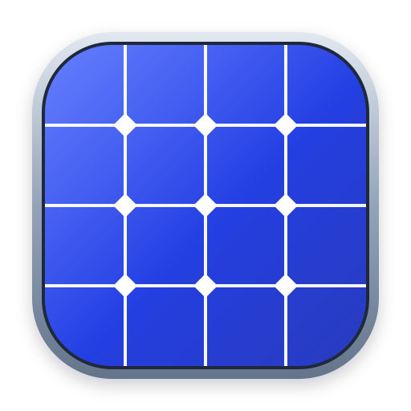

<p align="center">
  
</p>

<h1 align="center">DeyeDesktop</h1>

<p align="center">
  A fast, cross-platform desktop client for the <strong>Deye Cloud OpenAPI v1.0</strong>, built with <strong>C++20</strong>, <strong>Qt 6 (Qt Quick / QML)</strong>, and <strong>CMake</strong>.
</p>

## Features

- **Native Desktop Integration:** Automatically follows your system theme and accent color (`org.kde.desktop` on KDE Plasma, `FluentWinUI3` on Windows, `Fusion` fallback elsewhere).
- **Live Energy Overview:**
  - Animated Deye-style **Flow Graph** (Solar PV, Grid, Inverter, Battery SOC, Home Load) with directional energy pulses.
  - Real-time KPI cards for Solar Generation, Battery (SOC + charging/discharging power), Grid, and Home Load.
  - Interactive **Power Profile** chart (dual Y-axis kW / %, clickable legend toggles, date navigation, hover crosshair & tooltip).
  - Interactive **Generation & Usage History** stacked bar chart (**M / Y / T** views, clickable legend toggles, hover tooltips).
- **Devices & Inverter Settings:**
  - Plant device list sorted by Inverters → Batteries → Data Loggers / others (by serial number), with persistent local device renaming.
  - Full **Inverter Settings** dialog covering Deye Cloud OpenAPI v1.0 System, Battery, Time-of-Use (6 slots), and Custom Modbus controls.
- **Alerts & Push Notifications:** Fetches plant alerts (`/v1.0/station/alertList`) and sends native OS push notifications on active faults (via FreeDesktop D-Bus on Linux with no tray icon).
- **Multi-language UI:** Built-in **English** and **Polish (Polski)** localization selectable from the login screen (persisted locally).
- **Demo Mode:** Preview the full dashboard, charts, devices, inverter settings, and fault notifications without credentials.

---

## Prerequisites: Deye Cloud Developer Credentials

To connect to your real installation, you need an `App ID` and `App Secret`:
1. Sign in at [developer.deyecloud.com](https://developer.deyecloud.com) with your Deye Cloud account.
2. Create an application in the Developer Portal to obtain your **App ID** and **App Secret**.
3. Open **Developer API Settings** on the DeyeDesktop login screen, choose your region (`Europe / EMEA`, `Americas`, or Custom URL), and enter your `App ID` and `App Secret`.

---

## Building & Installing

> On Linux, `cmake --install` installs `deye-desktop`, its `.desktop` launcher entry (`applications/deye-desktop.desktop`), and hicolor icons (`scalable` SVG + `256x256` PNG), and refreshes the desktop/icon caches automatically so DeyeDesktop appears in your KDE/GNOME application menu.

### Arch Linux

Install dependencies:
```bash
sudo pacman -S --needed base-devel cmake ninja qt6-base qt6-declarative qt6-5compat
# Optional (recommended on KDE Plasma for native system widget styling):
sudo pacman -S --needed qqc2-desktop-style
```

Build and install:
```bash
git clone https://github.com/Szaru3/DeyeDesktop.git DeyeDesktop
cd DeyeDesktop
cmake -B build -G Ninja -DCMAKE_BUILD_TYPE=Release
cmake --build build

# System-wide install (binary + desktop entry + icon):
sudo cmake --install build

# Or user-local install (no sudo required):
cmake --install build --prefix ~/.local
```

---

### Fedora

Install dependencies:
```bash
sudo dnf install gcc-c++ cmake ninja-build qt6-qtbase-devel qt6-qtdeclarative-devel
# Optional (recommended on KDE Plasma):
sudo dnf install kf6-qqc2-desktop-style
```

Build and install:
```bash
git clone https://github.com/Szaru3/DeyeDesktop.git DeyeDesktop
cd DeyeDesktop
cmake -B build -G Ninja -DCMAKE_BUILD_TYPE=Release
cmake --build build

# System-wide install (binary + desktop entry + icon):
sudo cmake --install build

# Or user-local install (no sudo required):
cmake --install build --prefix ~/.local
```

---

### Ubuntu / Debian

> Requires **Qt 6.5+** (Ubuntu 24.04 LTS / Debian 13+ or newer).

Install dependencies:
```bash
sudo apt update
sudo apt install build-essential cmake ninja-build \
  qt6-base-dev qt6-declarative-dev \
  qml6-module-qtquick qml6-module-qtquick-controls \
  qml6-module-qtquick-layouts qml6-module-qtquick-templates
# Optional (recommended on KDE Plasma):
sudo apt install qml6-module-org-kde-desktop
```

Build and install:
```bash
git clone https://github.com/Szaru3/DeyeDesktop.git DeyeDesktop
cd DeyeDesktop
cmake -B build -G Ninja -DCMAKE_BUILD_TYPE=Release
cmake --build build

# System-wide install (binary + desktop entry + icon):
sudo cmake --install build

# Or user-local install (no sudo required):
cmake --install build --prefix ~/.local
```

---

### Windows

1. **Install Toolchain & Qt 6:**
   - Install **Visual Studio 2022** (with the *"Desktop development with C++"* workload) or **MinGW-w64**.
   - Install **CMake** (`>= 3.21`) and **Ninja** (or use the ones bundled with Visual Studio / Qt).
   - Install **Qt 6.5+** via the [Qt Online Installer](https://www.qt.io/download-qt-installer) (select the matching MSVC or MinGW kit — Qt Quick / Controls 2 and Network are included in the base kit).

2. **Configure & Build** (from a *Developer PowerShell for VS 2022* or Qt MinGW terminal):
   ```powershell
   git clone https://github.com/Szaru3/DeyeDesktop.git DeyeDesktop
   cd DeyeDesktop
   cmake -B build -G Ninja -DCMAKE_BUILD_TYPE=Release -DCMAKE_PREFIX_PATH="C:\Qt\6.8.0\msvc2022_64"
   cmake --build build
   ```
   *(Replace `C:\Qt\6.8.0\msvc2022_64` with your installed Qt kit path.)*

3. **Bundle Qt DLLs & Run:**
   ```powershell
   & "C:\Qt\6.8.0\msvc2022_64\bin\windeployqt.exe" --qmldir qml build\deye-desktop.exe
   .\build\deye-desktop.exe
   ```

---

## Running Unit Tests

```bash
ctest --test-dir build --output-on-failure
```
